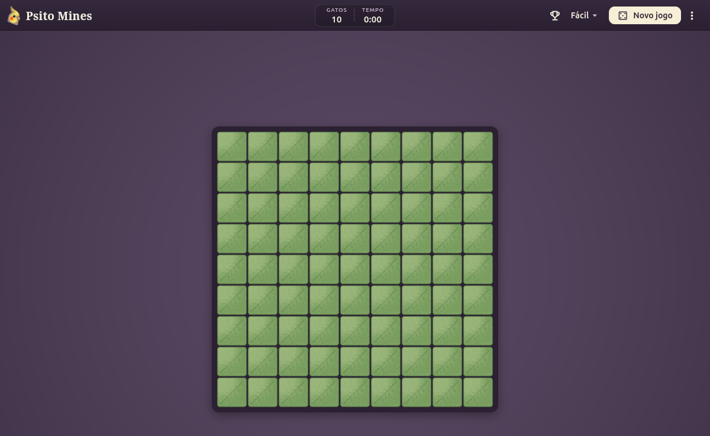

# Psito Mines

Find the cats hiding under the leaves, with cockatiels, for Windows and Linux, built
with Flutter. No ads, no telemetry and no account: just a little game and some happiness.



**[Website](https://francisceioseph.github.io/psito-mines/)**

## Features

- Three difficulties: 9 × 9 with 10 cats, 16 × 16 with 40 and 30 × 16 with 99
- The first leaf is always safe, and so are the ones around it
- Feathers mark the leaves you suspect; a click on a number lifts the leaves around it
- A local table of your best times for each difficulty, kept only on your computer
- Leaves that open in a wave from the leaf you clicked
- A curious cockatiel that peeks from every edge of the garden when you stop to think
- Keyboard shortcut: `Ctrl+N` starts a new game
- English and Portuguese

## Install

### On Windows

Windows 10 version 1809 or newer, or Windows 11, on x64. Download
[the installer](https://github.com/francisceioseph/psito-mines/releases/latest/download/psito-mines-windows-x64-setup.exe)
and run it. It doesn't ask for administrator rights.

The installer isn't signed with a paid certificate, so SmartScreen may warn that it
comes from an unknown publisher: choose **More info**, then **Run anyway**. New
versions are installed the same way, over the old one.

### From the APT repository

On Debian 13 or newer, Ubuntu 24.04 or newer, or Mint 22 or newer. It updates along with the system:

```bash
sudo mkdir -p /etc/apt/keyrings
curl -fsSL https://francisceioseph.github.io/psito-mines/psito-mines.asc | sudo tee /etc/apt/keyrings/psito-mines.asc >/dev/null
printf 'Types: deb\nURIs: https://francisceioseph.github.io/psito-mines\nSuites: stable\nComponents: main\nArchitectures: amd64\nSigned-By: /etc/apt/keyrings/psito-mines.asc\n' | sudo tee /etc/apt/sources.list.d/psito-mines.sources >/dev/null
sudo apt update
sudo apt install psito-mines
```

### From the DNF repository

On Fedora, on x86_64. It updates along with the system, and the first install asks you to accept the signing key:

```bash
sudo curl -fsSL -o /etc/yum.repos.d/psito-mines.repo https://francisceioseph.github.io/psito-mines/psito-mines.repo
sudo dnf install psito-mines
```

### From the source

You need Flutter 3.47 and the system libraries. On Debian, Ubuntu or Mint:

```bash
sudo apt install libgtk-3-dev ninja-build cmake clang pkg-config
```

Then build a package that installs for everyone, and needs no Flutter to run:

```bash
tool/build-deb.sh
sudo apt install ./build/deb/psito-mines_*_amd64.deb
```

## Develop

```bash
flutter run -d linux
flutter analyze
flutter test
```

The rules live in `lib/src/game/`, in Dart with no interface, and the garden
and the animations in `lib/src/ui/`. Texts live in the `.arb` files in `lib/l10n/`, in
both languages. `tool/prepare_art.py` draws the tiles in `assets/tiles/`.

## Psito Games

Psito Mines is part of Psito Games, a suite of casual games made in the spirit of
the ones that came with Windows 7, alongside
[Psito Cell](https://github.com/francisceioseph/psito-cell) and
[Psito Solitaire](https://github.com/francisceioseph/psito-solitaire).

## License

The code is under the [Apache License 2.0](LICENSE) and the art under
[CC0](assets/LICENSE.md). See [the third-party licenses](THIRD_PARTY_LICENSES.md).
